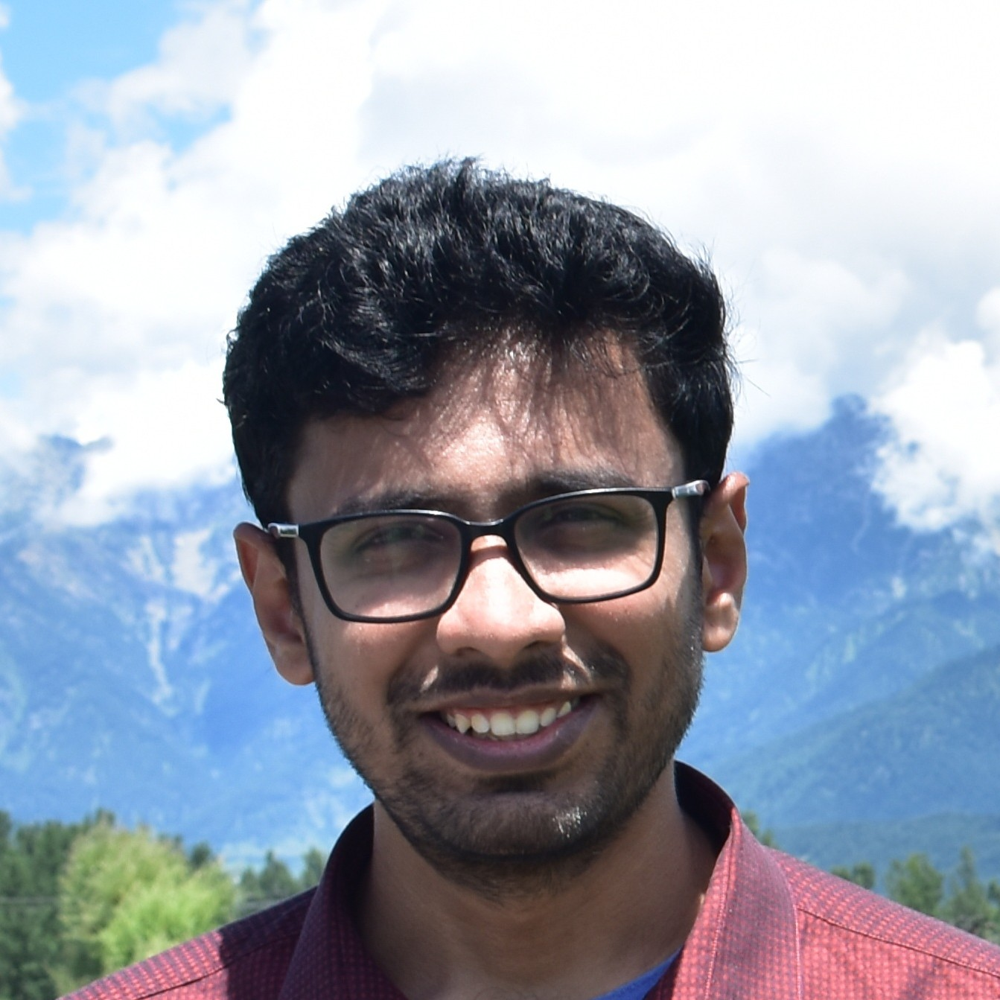

Hi, I am a postdoc in Theoretical Computer Science at the [University of Regensburg](https://www.uni-regensburg.de/) hosted by [Radu Curticapean](https://www.uni-regensburg.de/en/informatics-data-science/faculty/facilities/algorithms-and-complexity-theory/team/radu-curticapean). 

I did my PhD at the [Indian Institute of Technology Kanpur](https://www.iitk.ac.in/), where I was fortunate to be advised by [Nitin Saxena](https://www.cse.iitk.ac.in/users/nitin/). I found my way into Theoretical Computer Science at [Chennai Mathematical Institute](https://www.cmi.ac.in/) guided by [Partha Mukhopadhyay](https://www.cmi.ac.in/~partham/).

I am broadly interested in problems of [Computational Complexity](https://en.wikipedia.org/wiki/Computational_complexity) with some algebraic flavour.

Contact: bhargav.cs@pm.me (preferred), bhargav.cs@ur.de

## Explore

- [[research/index|Research]] — papers, manuscripts, and theses.
- [[talks/index|Talks]] — presentations and tutorials.
- [[resources/index|Resources]] — books, courses, and articles I find useful.
